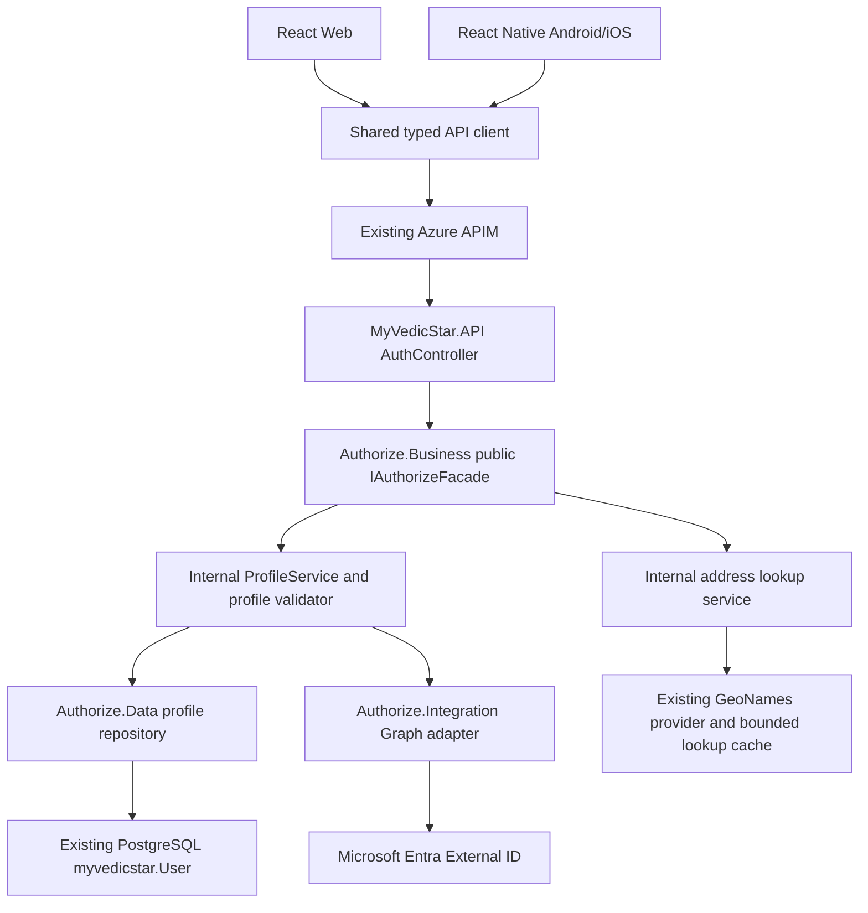

# User profile management: architecture proposal

Status: implemented in the UI and MyVedicStar backend under the requested repository standards. Deployment verification is recorded in ../deployment-readiness.md.

Governing standards: `../myvedicstar/.github/copilot-instructions.md`, especially sections 3–7, 11–14, 20, 28, and 31–36.

## Requirements and scope

Add Profile above Settings and Log out in the signed-in web account menu. Provide the same profile functionality on React Native Android/iOS. Display ten editable fields in the requested order, load the existing account, update only changed fields, and preserve authentication, account status, issuer, and audit history.

Use the existing PostgreSQL `myvedicstar.User` table and existing GeoNames provider. Keep `POST /api/v1/auth/userinfo` and its Id/Name/Email response unchanged. Opening Profile must never register an account or append a login audit event.

## Projects, dependencies, and responsibilities

- **MyVedicStar.API:** request/response DTOs, authentication, authorization, rate limits, OpenAPI documentation, response mapping, and thin controller actions that call the public facade.
- **MyVedicStar.Authorize.Business:** facade contracts, internal profile orchestration, validation, name-change detection, partial-success handling, and geography orchestration. No service locator or provider-specific HTTP code.
- **MyVedicStar.Authorize.Data:** issuer/object-ID-scoped reads and updates, optimistic concurrency, durable synchronization state, and migrations. Database entities and persistence DTOs stay in Data; they do not become API response contracts.
- **MyVedicStar.Authorize.Integration:** Microsoft Graph adapter behind an interface, strongly typed validated options, credentials, HTTP timeout/cancellation, and redacted operational logging. Graph integration has been retired in the current repository, so this capability must be restored deliberately rather than assuming an existing implementation.
- **GeoNames:** extend the existing provider for countries, administrative regions, and region-filtered city suggestions, reusing its HTTP client, bounded cache, quota handling, and error behavior. Expose additions through a Business facade; controllers must not call the provider directly.
- **Shared frontend packages:** API DTO validators, profile input validation, changed-field payload generation, and common TanStack Query hooks. Platform views use existing components and theme tokens.

No new service, database, paid geography provider, or hosting infrastructure. No changes to Panchang calculations or their dependencies.

## Data design and migrations

Retain existing `given_name`, `family_name`, Email, Id, ExternalId, Issuer, IsActive, timestamps, and audit relationships. Add nullable street address, second street address, country, state/province, city, postal code, and phone columns through EF Core migrations.

Add a profile revision for optimistic concurrency, a flag protecting explicitly edited values from later token-claim upserts, and durable pending flags for each name attribute. Keep synchronization state in the user table; do not create a profile table.

Generate and inspect the migration and model snapshot using the existing EF tooling. Test against the current migration chain, which includes older name-column transformations. Do not infer first/last names by splitting the userinfo display name.

Reads do not insert accounts. Updates use issuer and external object ID obtained from verified claims, require an active existing account, and update only whitelisted changed fields. Concurrent saves must produce a meaningful conflict and retain the newer values.

## Additive API contracts

| Endpoint                                                              | Behavior                                                                                             |
| --------------------------------------------------------------------- | ---------------------------------------------------------------------------------------------------- |
| GET `/api/v1/auth/profile`                                            | Read only the authenticated user's existing profile.                                                 |
| PATCH `/api/v1/auth/profile`                                          | Validate `{ revision, changes }`, persist changed fields, then attempt pending name synchronization. |
| POST `/api/v1/auth/profile/sync`                                      | Retry durable pending synchronization without changing unrelated profile fields.                     |
| GET `/api/v1/locations/countries`                                     | Worldwide country options from the existing GeoNames adapter.                                        |
| GET `/api/v1/locations/regions?country=XX`                            | Administrative regions for the selected country.                                                     |
| GET `/api/v1/locations/address-cities?country=XX&region=...&text=...` | City suggestions filtered by country and known administrative region.                                |

Use the existing postal endpoint for postal lookup. Preserve existing search/reverse/timezone routes and contracts.

Profile response: id, firstName, lastName, streetAddress, streetAddress2, country, state, city, postalCode, email, phoneNumber, revision, and nameSyncPending. Empty database values remain nullable; UI fields render empty strings.

Map public Business results to API response DTOs. Use the existing global RFC 7807 error handling, with validation, unauthorized, inactive-account, not-found, conflict, quota, and unavailable responses documented in OpenAPI. Never expose provider responses, SQL errors, credentials, or stack traces.

## Authentication and Microsoft Graph

Use the existing API scope policy. No browser-supplied user ID is accepted for profile ownership or Graph targeting. Use a verified Entra `oid` claim and validate its issuer against the configured External ID tenant. Federated sign-ins target that Entra object; no original Google/Facebook/Apple account is modified.

Use backend credentials through the existing configuration and Azure identity conventions. Strongly typed Graph options must validate the selected credential mode, tenant, and required client settings. No secrets in source or browser configuration.

PATCH only changed `givenName` and/or `surname`. Request the least Graph application permissions needed for this operation; configure tenant admin consent through the existing deployment process. Do not request broad Directory permissions or modify displayName, email, passwords, or social accounts.

Commit PostgreSQL changes and pending flags before contacting Graph. If Graph fails, return the saved profile with pending synchronization and show a partial-success message with safe retry. Pending work survives process restarts.

Serialize synchronization per account across API instances using PostgreSQL coordination. Read the latest pending work while holding the synchronization lock and clear pending flags only for the revision actually synchronized. Tests must cover concurrent saves/retries and stale completion so older Graph calls cannot overwrite newer synchronized names.

## Worldwide address editing

Searchable country options display country names while retaining stable ISO country codes. Regions depend on country; city queries use the selected country and region code when known. Countries without states or postal codes remain valid.

Changing country clears state, city, and postal fields; changing state clears city and revalidates postal information. GeoNames selection may fill reliable geography values but never street address fields. Unknown/manual region names remain editable and must not cause misleading region-filtered results.

Debounce requests, cancel stale queries, and reuse TanStack Query keys and the existing GeoNames cache/error handling. Always allow manual entry when lookups are disabled, unavailable, incomplete, or return no results. Lookup availability is not a condition for saving a valid address.

Validate email, international phone characters and digit counts, maximum lengths, postal characters, and known country formats. Allow empty optional fields and addresses without postal codes. Validation must agree between backend and frontend.

## Web, mobile, caching, and accessibility

Use existing web buttons, input styling, responsive layouts, navigation, and React Native form controls. Include all ten fields at initial render, with loading/disabled states until the existing profile arrives. Use labels, field errors, keyboard navigation, accessible suggestions, touch targets, and status announcements.

Disable duplicate Save and synchronization submissions. Avoid discarding unsaved edits during retries, refetches, or synchronization. Show saved, partial-success, validation, load, and save-error states with actionable recovery.

Keep profile data only in client session memory; exclude it from persistence. Scope profile query keys to the signed-in account and clear them on logout/account changes. Backend profile responses use no-store; no profile cache is introduced server-side.

After save, accept the authoritative returned profile and refresh/invalidate the appropriate profile/userinfo queries without duplicate requests. The displayed menu name/email and greeting should reflect the updated profile immediately; preserve the backend's existing userinfo contract.

Add a mobile Profile route and signed-in entry point. Preserve current mobile navigation and authentication. Verify phones, tablets, rotation, and foldable widths using the existing layout conventions.

## Observability and security

Reuse global request correlation, logging, and exception handling. Add Graph operation duration/status/outcome logging and synchronization outcome metrics without logging names, addresses, emails, telephone numbers, tokens, request bodies, or provider response bodies.

Use bounded timeouts and CancellationToken throughout. Retry only safe, transient operations; retain pending work for explicit retry after non-transient failures. Do not hold local profile changes hostage to Graph availability. Maintain request-size limits, rate limits, input whitelists, no-store responses, and account isolation.

## Packages and configuration

Use existing EF Core/Npgsql, Azure.Identity, Microsoft Extensions Options/DI/logging/HTTP infrastructure, and xUnit test conventions. Prefer the existing HTTP stack for Graph PATCH rather than adding a full SDK for two attributes. Frontend uses existing Zod, TanStack Query, React, and Expo dependencies.

Add production endpoint overrides through the existing public runtime configuration generator. Document required backend Graph settings and deployment/APIM method coverage. Restore Graph credential configuration only through existing secret-management conventions; no secret values are placed in this proposal.

## Implementation phases and validation

1. **Contracts and architecture alignment:** correct the unfinished draft to use IAuthorizeFacade, API-owned DTOs, explicit constructor injection, typed Graph options, and internal services. Add contract and validation tests.
2. **Data:** add migration and profile repository; test existing-row reads, account isolation, inactive accounts, changed-field updates, preservation of login history, concurrency, and token-upsert behavior.
3. **Business and integration:** add Graph adapter/orchestration; test changed attributes only, no-name-change saves, verified identity, tenant restrictions, partial failure, durable retry, and concurrent synchronization. Use controlled fake providers.
4. **Geography:** extend the existing provider through the facade; test countries, regions, region-filtered cities, postal coverage, quota failures, manual fallback, and dependent-field resets.
5. **Web and mobile:** implement routes, menus, editors, accessible suggestions, cache lifecycle, status messages, and responsive behavior; test menu order/navigation, prefill, save, errors, and synchronization retry.
6. **Verification:** compile all affected .NET projects; run Authorize unit/integration tests and GeoNames tests; run frontend lint/format/type checks and targeted shared/web/mobile tests. Validate production configuration and document any environment-dependent checks.

Database and Graph live checks require configured test credentials and a disposable test database. Passing fake-provider tests does not establish that tenant consent or production APIM configuration is correct. No deployment, migration application, or live Graph mutation is part of architecture approval.

## Draft audit before further implementation

The first backend draft must be corrected before it is considered reviewable implementation:

- AuthController currently calls a profile service directly; route all operations through IAuthorizeFacade.
- The draft exposes a Data profile result in API actions; add Business and API-owned contracts and mappings.
- ProfileService currently resolves a repository through IServiceProvider; replace it with explicit DI and a disabled-persistence strategy.
- Graph configuration currently reads IConfiguration directly; use typed validated options and inject the HTTP client/credential adapter according to project conventions.
- Add Graph operational logging and cross-instance synchronization coordination.
- Generate the EF migration and complete backend/frontend/mobile tests before claiming completion.
- Complete mobile functionality, runtime routes, cache/session behavior, accessible geography controls, and meaningful conflict/error recovery.

Implementation follows these phases under the repository standards. Apply the deployment prerequisites in the readiness report before production rollout.
