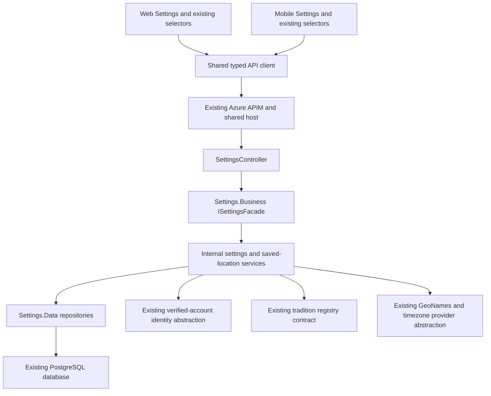

# User settings management: architecture proposal

Status: implemented in the UI and MyVedicStar backend under the requested repository standards. Deployment verification is recorded in ../deployment-readiness.md.

Governing standards: `../myvedicstar/.github/copilot-instructions.md`. This proposal follows the mandatory public-facade boundary, explicit dependency injection, layer-owned DTOs, existing migration conventions, and architecture approval requirement in section 35.

## Requirements and current implementation

Settings manages Default Tradition, Default Location, and Saved Locations for the authenticated account. PostgreSQL is authoritative across devices. Temporary location/tradition changes must never write saved defaults.

The current web `LocationStateProvider` and mobile `LocationProvider` maintain selected/recent locations in device storage. Their selectors already use the shared GeoNames location service and TanStack Query cache. Web `TraditionStateProvider` and mobile `TraditionProvider` maintain local tradition choices. The existing Settings route is a placeholder.

Reuse these providers and selectors rather than introducing another geography integration. Retain anonymous storage/default behavior. Keep server-owned account saved locations separate from anonymous recent locations; do not silently upload the anonymous recent list on login.

## Projects and dependency boundaries

Use product/domain naming:

- `MyVedicStar.API`: new SettingsController, API-owned request/response models, authenticated routing, validation coordination, response mapping, and OpenAPI documentation.
- `MyVedicStar.Settings.Business`: public ISettingsFacade; internal settings and saved-location services; validation, default-selection rules, ownership coordination, and duplicate handling.
- `MyVedicStar.Settings.Data`: repositories, internal EF entities/context, settings-schema migrations, transaction handling, and database configuration through existing connection/credential conventions.
- `MyVedicStar.Settings.Integration`: add only if an adapter is needed to connect existing GeoNames/timezone validation to the Settings domain. It must delegate to the existing provider, not implement another GeoNames HTTP client. An empty project or duplicate integration is unnecessary.
- Appropriate Settings unit/integration test projects, registered in the existing solution and deployment solution where required.

Controllers never access repositories, contexts, internal services, caches, or external providers. API DTOs are mapped from Business results; database entities do not cross the API boundary. Business uses explicit constructor dependencies and layer-specific DI registration extensions.

Expose or reuse a narrowly scoped existing-account lookup contract from Authorize.Business. It reads the existing user's internal ID from verified issuer/object-ID claims without registering accounts or recording login events. Settings must not reference Authorize implementation classes or duplicate claim-parsing rules.

Panchang calculations and their caching architecture remain unchanged.

## PostgreSQL design

Use the existing database and new `myvedicstarsettings` schema.

| Table              | Data and constraints                                                                                                                                                          |
| ------------------ | ----------------------------------------------------------------------------------------------------------------------------------------------------------------------------- |
| UserSettings       | UserId primary key and foreign key to existing `myvedicstar.User`; nullable DefaultTradition and DefaultLocationId; revision/timestamps for concurrency. One row per account. |
| UserSavedLocations | LocationId primary key; UserId foreign key; city, state/province, country, postal code, latitude, longitude, IANA timezone; normalized location identity and timestamps.      |

Use a composite foreign key `(UserId, DefaultLocationId)` referencing `(UserId, LocationId)` so a default cannot reference another account's location. Add the corresponding unique key on saved locations.

Define a deterministic geography identity from normalized coordinates and validated IANA timezone, using the existing SelectedLocation coordinate precision conventions. Names and postal labels do not determine duplicate identity; differently formatted labels for the same coordinates/timezone must not create duplicates. Enforce uniqueness on `(UserId, location identity)` in PostgreSQL, including concurrent inserts. Do not use a coarse calculation-cache coordinate rounding policy for saved-location identity.

Add locations idempotently: a concurrent duplicate returns the already saved location. Generate IDs on the backend. Scope every location read/update/delete by both authenticated UserId and LocationId.

Deleting a default location clears DefaultLocationId and deletes the location in one transaction. The UI then applies the existing location fallback. Deleting any other location or adding a location leaves the saved default unchanged.

Generate migrations with EF Core and inspect the generated snapshot. Settings owns its migration history in `myvedicstarsettings`. Apply Authorize migrations before settings foreign keys are created. Reuse database authentication, TLS, retries, health checks, and controlled deployment migration conventions. Never auto-apply production migrations as part of ordinary API requests.

Preserve all profile/authentication/audit records and unrelated tables. GET settings returns empty defaults when no settings row exists; it does not create a row. Explicit Save creates or updates the single settings row.

## Additive API contracts

| Method and path                                  | Behavior                                                                                                                       |
| ------------------------------------------------ | ------------------------------------------------------------------------------------------------------------------------------ |
| GET `/api/v1/settings`                           | Current account's defaults, revision, and optionally the resolved default saved location to avoid a duplicate startup request. |
| PUT `/api/v1/settings`                           | Explicitly save `{ defaultTradition, defaultLocationId, revision }`; null clears a default.                                    |
| GET `/api/v1/settings/locations`                 | Current account's saved locations, with bounded paging if needed.                                                              |
| POST `/api/v1/settings/locations`                | Save a validated selected location; return its canonical saved record, reusing a duplicate.                                    |
| DELETE `/api/v1/settings/locations/{locationId}` | Delete only the current account's record; return updated defaults when deleting the default.                                   |

No arbitrary UserId is accepted. Use the existing API-scope authorization policy, inactive-account restrictions, rate limiting, request-size limits, no-store headers, correlation handling, and centralized RFC 7807 errors. Preserve userinfo, authentication, GeoNames, and calculation contracts.

Validate tradition keys against the existing supported registry, not a new copied list. Validate finite coordinate ranges, IANA timezone, field lengths, and ownership of defaultLocationId. Use the existing provider/resolver to establish trusted timezone information when necessary; do not accept an arbitrary timezone merely because its spelling is valid.

Document 400 validation, 401 authentication, 403 authorization/inactive-account, 404 missing/foreign-owned location, 409 concurrent settings change, 429 quota, and 503 dependency failures. Foreign-owned IDs must not reveal another user's data.

## Login defaults and temporary state

Load settings once per authenticated session through an account-scoped TanStack Query. Resolve saved defaults and apply them to the existing location/tradition providers before authenticated calculations use their initial context when practical. Handle loading failures visibly while preserving the existing fallback behavior; retry must not trap users in a login loop.

Apply defaults once on login/account restoration, not on every background refetch or screen mount. A late settings response must not overwrite an explicit temporary choice made while the request was in progress. Reuse choice-generation tracking already present in location providers and add equivalent tracking for tradition.

Provide separate actions for applying a stored default and selecting a location interactively. Applying defaults, hydrating saved records, and refetching queries must not trigger location-save POSTs or loop back into preference writes.

Interactive location selection updates the active location immediately and saves the account location asynchronously. A failed save is reported with retry; it must not falsely mark the location as persisted or silently change the saved default. Selecting an already saved location does not send another insert request.

Temporary tradition/location choices remain separate from PostgreSQL defaults. Only Save in Settings updates default values. After Save, apply the returned defaults to active providers and update shared query state. Account switches/logout clear account-specific settings and locations; restore anonymous behavior without leaking the previous account's locations.

## Settings and saved locations UI

Replace the Settings placeholder with an accessible form using the existing supported tradition list and all saved account locations. Populate persisted values, provide Save, disable repeated submissions, and show validation, loading, success, conflict, and error states.

Display saved locations in the existing location dialog/sheet and Settings. Keep saved-account and anonymous-recent concepts clear. All saved locations must remain accessible; do not truncate the database list to the current ten-item recent limit. Show loading/empty/error states and accessible delete controls. Confirm default deletion's fallback consequence in the UI where needed without adding a separate authorization flow.

Delete operations update the visible list and defaults immediately after server confirmation. Preserve the current active location when deleting an unrelated record. If the deleted record is the active default, apply existing fallback behavior and display the cleared-default state.

Implement web and React Native Android/iOS with shared contracts/hooks and platform-native controls. Preserve theme tokens, keyboard navigation, screen-reader labels, large text, tablet/foldable layouts, and mobile touch targets.

## Cache and synchronization

Scope settings and saved-location query keys to the authenticated account. Keep private data in session memory and excluded from the existing persisted public calculation cache. Backend settings/location responses are no-store; no server preference cache is introduced.

After save/add/delete, use the authoritative mutation response and invalidate only affected account queries. Update defaults and locations together when deleting a default. Cancel stale account requests on logout/account switch, and never write a late mutation response into the next account's cache.

Fetch from PostgreSQL on a fresh login/device. Background refresh may update saved lists but must not reset temporary active choices. Cross-device updates become visible on next login or explicit refresh; realtime infrastructure is unnecessary.

## Configuration, observability, and security

Register Settings through layer-specific DI extensions in the existing shared host. Add required endpoint overrides to production runtime configuration and include the new paths/methods in existing APIM definitions and deployment packaging. No new Azure infrastructure.

Use existing EF Core/Npgsql, options, logging, and HTTP infrastructure; frontend uses existing Zod/TanStack Query/React/Expo. Add integration dependencies only when actual responsibilities require them.

Reuse request tracing and global exception mapping. Record operation duration, outcome, and duplicate/conflict counts without logging address details, coordinates beyond existing privacy policies, tokens, secrets, or request bodies. Support bounded timeouts and cancellation throughout.

## Phases and testing

1. Define facade, Business results, API DTOs, ownership lookup, and shared frontend contracts; align with the implemented profile architecture.
2. Add Settings.Data context/repositories/migrations and tests for single settings rows, account foreign keys, concurrent deduplication, atomic default deletion, and preservation of existing account/audit data.
3. Implement facade/internal services, tradition validation, trusted location validation, API endpoints, DI/configuration, structured operational logging, and Problem Details tests.
4. Connect account-scoped startup queries to existing providers; test default application, no-settings fallback, temporary overrides, late-response races, account changes, and lack of unintended default writes.
5. Build web/mobile Settings and saved-location controls; test prefill, Save, automatic location saving, errors/retry, deletion, query invalidation, and accessible responsive behavior.
6. Compile affected .NET projects, run Settings/Authorize/GeoNames unit and integration tests, and run relevant frontend format/lint/type/shared/web/mobile tests. Validate production route generation and document live APIM/database checks that require configured environments.

Essential regression coverage includes Today, Calendar, Find Good Time, userinfo, login/logout, anonymous selectors, existing tradition lists, cross-device login, duplicate simultaneous inserts, missing/foreign default IDs, deletion racing with default Save, and failures without false success or lost temporary choices.

Profile and Settings are implemented together. Production deployment and migration application remain separate rollout actions.
